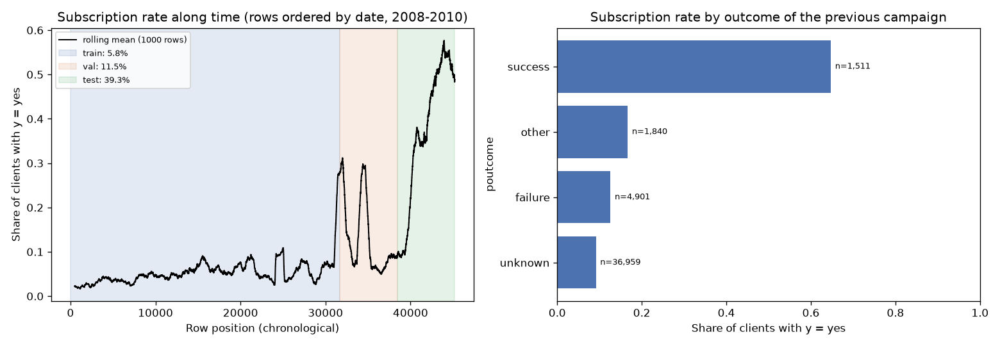
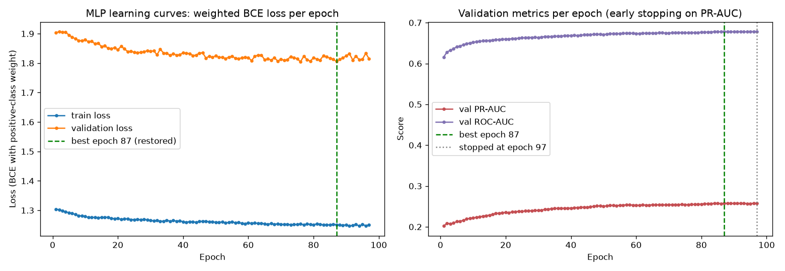
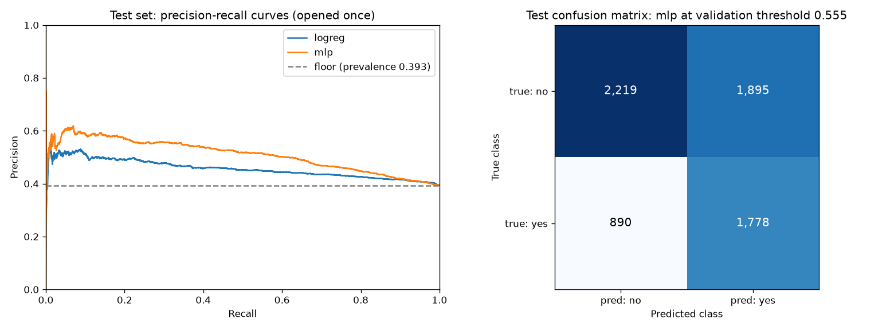

# BankNextAction AI

**Banking Campaign Intelligence & Customer Propensity Platform.** Estima la probabilidad de que un cliente contrate un depósito a plazo usando solo información disponible **antes** de contactarlo, y la sirve como una API FastAPI reproducible en Docker.

> Proyecto Final · Módulo 1 · Diplomado en AI & LLMs for Financial Markets (ITAM).
> Modelo ilustrativo para aprendizaje: no es asesoría financiera ni prueba causal de la efectividad de una campaña.

**Autor:** Maximino Jiménez Robles · GitHub: [@MaxRobles1](https://github.com/MaxRobles1)

**English summary.** Supervised propensity model on the UCI Bank Marketing dataset (pre-contact features only, chronological train/validation/test split). It compares a scikit-learn pipeline (ColumnTransformer + LogisticRegression, tuned with GridSearchCV over a TimeSeriesSplit) with a PyTorch MLP (explicit training loop, early stopping with weight restoration, resumable checkpoint). The served model (MLP) is chosen on validation only. The test split is opened once. Both models beat the PR-AUC floor, and the margin is modest. Everything ships in a reproducible Docker image built from `uv.lock`.

---

## Instalación

Requisitos: Git, [uv](https://docs.astral.sh/uv/) 0.13 o superior y Docker (solo para la imagen).

```bash
git clone https://github.com/MaxRobles1/banknextaction-ai-platform.git
cd banknextaction-ai-platform
uv sync --locked                 # entorno .venv con Python 3.11, exactamente lo del lockfile
cp .env.example .env             # opcional: no se requieren secretos
uv run pre-commit install        # solo si vas a contribuir (hooks de calidad y seguridad)
```

## Ejecución

Los comandos se corren desde la raíz del repositorio. Los modelos entrenados ya vienen versionados en `models/`, así que **no hace falta reentrenar** para levantar el servicio.

| Paso | Comando |
|---|---|
| 1. Datos: descarga de UCI, verificación SHA-256, manifiesto y figura EDA | `uv run python scripts/prepare_data.py` |
| 2. Entrenar ambos modelos (solo train y val; umbral en val) | `uv run python scripts/train.py` |
| 3. Selección con validación y evaluación única en prueba | `uv run python scripts/evaluate.py` |
| Pruebas (39) | `uv run pytest` |
| Linter y formato | `uv run ruff check . && uv run ruff format --check .` |
| Todos los hooks | `uv run pre-commit run --all-files` |

### Interfaz web de scoring

Con el servicio en marcha (con o sin Docker), abre **http://localhost:8000/**. La página lee el contrato de `/predict` desde `/openapi.json`, muestra el formulario con etiquetas de negocio y envía los datos al endpoint real. El resultado incluye la probabilidad, la clase, el umbral, el modelo y la latencia medida; no hay inferencia en el navegador.

**Ejemplo con un perfil ficticio:** presiona **Cargar ejemplo ficticio** y luego **Calcular propensión**.
- **Primer ejemplo** (41 años, gerencial, sin contacto previo): **44.3 %**, por debajo del umbral de 55.5 %.
- **Segundo ejemplo** (con éxito en la campaña anterior): supera el umbral.

Desde otro dispositivo de la misma red, abre `http://<IP-de-la-Mac>:8000/`.

### Servicio sin Docker

```bash
uv run uvicorn banknextaction.api.app:app --host 0.0.0.0 --port 8000
# http://localhost:8000/docs  (interfaz interactiva de la demo)
```

### Servicio con Docker

```bash
docker build -t banknextaction .
docker run --rm -p 8000:8000 banknextaction
```

Probar el servicio:

```bash
curl http://localhost:8000/health
curl -X POST http://localhost:8000/predict -H "Content-Type: application/json" \
  -d '{"age":41,"job":"management","marital":"married","education":"tertiary","default":"no",
       "balance":1500,"housing":"yes","loan":"no","pdays":-1,"previous":0,"poutcome":"unknown"}'
```

Respuesta real del servicio para esa entrada:

```json
{"subscription_probability":0.44276,"non_subscription_probability":0.55724,"predicted_class":0,
 "decision_threshold":0.555,"model_name":"mlp","model_version":"0.1.0","inference_time_ms":8.144}
```

Desde otra máquina de la misma red: `ipconfig getifaddr en0` (macOS) da la IP y se abre `http://<IP>:8000/docs`.

| Endpoint | Qué hace |
|---|---|
| `GET /health` | Estado, modelo servido, versión, umbral, fecha de los artefactos y sus hashes |
| `POST /predict` | Valida la entrada con Pydantic (rangos, categorías, `extra="forbid"`; error **422** si no cumple) y devuelve probabilidad, clase y umbral |
| `GET /docs` | Documentación OpenAPI interactiva |
| `GET /` | Interfaz web de scoring (HTML/CSS/JS servidos por la misma API) |

## Problema y dataset

**Pregunta.** Dado el perfil de un cliente y su historial conocido **antes** de la campaña, ¿qué probabilidad hay de que contrate el depósito a plazo?

**Dataset.** [UCI Bank Marketing](https://archive.ics.uci.edu/dataset/222/bank+marketing), archivo `bank-full.csv`:
- 45,211 filas y 17 columnas.
- Banco portugués, campañas de mayo de 2008 a noviembre de 2010.
- Licencia **CC BY 4.0**, DOI [10.24432/C5K306](https://doi.org/10.24432/C5K306).
- Cita: S. Moro, P. Rita y P. Cortez, *Bank Marketing*, UCI Machine Learning Repository, 2012.
- El CSV no se versiona. `scripts/prepare_data.py` lo descarga y verifica su SHA-256 (`d1513ec6…`); toda la trazabilidad queda en [`data/manifests/bank_full.json`](data/manifests/bank_full.json).

| Variables usadas (precontacto) | Excluidas y por qué |
|---|---|
| Numéricas: `age`, `balance`, `pdays`, `previous` | `duration`: duración de la llamada actual, solo se conoce después; es fuga directa |
| Categóricas: `job`, `marital`, `education`, `default`, `housing`, `loan`, `poutcome` | `campaign`, `contact`, `day`, `month`: se deciden durante la campaña |

**Etiqueta:** `y` (yes = 1, no = 0).

**Preparación:**
- `pdays = -1` significa "nunca contactado" y se transforma en un indicador más los días transcurridos.
- `balance` y `previous` reciben log con signo (colas largas).
- `unknown` se conserva como categoría, porque es información.
- Todo ocurre dentro de un `ColumnTransformer` ajustado solo con los datos de entrenamiento de cada fold.

**Partición.** El archivo está ordenado por fecha, así que la partición es un corte cronológico 70/15/15, sin barajar. La validación cruzada usa `TimeSeriesSplit` solo dentro de entrenamiento, y la prueba se abre una sola vez.

| Partición | Filas | Positivos | Prevalencia | Piso de accuracy (clase mayoritaria) |
|---|---|---|---|---|
| train | 31,647 | 1,840 | 5.8 % | 0.942 |
| val | 6,782 | 781 | 11.5 % | 0.885 |
| test | 6,782 | 2,668 | 39.3 % | 0.607 |

La tasa de contratación **cambia mucho en el tiempo** (figura 1). Por eso el piso se reporta por partición. Ver [D-014](docs/DECISIONS.md).



## Resultados

### Modelo A: Pipeline de scikit-learn

`Pipeline(ColumnTransformer → LogisticRegression)` con `GridSearchCV` sobre `TimeSeriesSplit(5)` del conjunto de entrenamiento. La búsqueda se optimiza por PR-AUC y también registra ROC-AUC.

| Hiperparámetros probados | Ganó |
|---|---|
| `C` ∈ {0.01, 0.1, 1, 10} × `class_weight` ∈ {None, balanced} (8 combinaciones) | `C=0.01`, `class_weight=None` (PR-AUC de CV 0.087 ± 0.032) |

### Modelo B: MLP en PyTorch

**Arquitectura:** `Linear(34→64) → ReLU → Dropout(0.2) → Linear(64→32) → ReLU → Dropout(0.2) → Linear(32→1)`.

**Entrenamiento:**
- **Pérdida y optimizador:** `BCEWithLogitsLoss` con peso de la clase positiva calculado en train, y Adam con lr 1e-4.
- **Bucle:** cada época se entrena en modo `train()` y se valida en `eval()` dentro de `no_grad()`, guardando la historia completa.
- **Paro temprano:** monitorea la PR-AUC de validación con paciencia 10. **Se detuvo en la época 97 y restauró los pesos de la mejor, la 87.**
- **Checkpoint completo** (pesos, optimizador, época y mejor métrica) en `models/mlp_checkpoint.pt`; se puede reanudar.



**Diagnóstico de las curvas** (las cuatro formas de la Clase 9):
- **Primera corrida (lr 1e-3):** la pérdida de validación *brincaba* mientras la de entrenamiento bajaba. Bajé la tasa 10 veces (lr 1e-4) y la validación quedó unas 9 veces más estable, con igual o mejor PR-AUC.
- **Resultado final:** las dos curvas bajan juntas y se aplanan, con una brecha estable que no crece (no hay "tijeras", no memoriza). La mejora ya no vendría del entrenamiento sino de los datos.

Detalle en [D-015](docs/DECISIONS.md).

### Comparación de los dos modelos (mismas métricas, con su piso)

Cada modelo usa su umbral elegido en **validación**, aplicado tal cual a **prueba**:

| Modelo | Split | Umbral | ROC-AUC | PR-AUC | F1 | Precisión | Recall | Accuracy | Piso accuracy | Piso PR-AUC |
|---|---|---|---|---|---|---|---|---|---|---|
| Pipeline LogReg | val | 0.060 | 0.656 | 0.233 | 0.276 | 0.191 | 0.496 | 0.701 | 0.885 | 0.115 |
| Pipeline LogReg | test | 0.060 | 0.581 | 0.456 | 0.531 | 0.438 | 0.675 | 0.531 | 0.607 | 0.393 |
| **MLP (servido)** | val | 0.555 | 0.678 | 0.258 | 0.312 | 0.254 | 0.402 | 0.795 | 0.885 | 0.115 |
| **MLP (servido)** | test | 0.555 | 0.636 | 0.509 | 0.561 | 0.484 | 0.666 | 0.589 | 0.607 | 0.393 |



**Conclusión.**
- **Elección:** conviene el **MLP**. Se eligió por su F1 en validación, sin mirar la prueba. En prueba supera el piso de PR-AUC por 0.116 (la regresión logística, por 0.063) y responde en ~1.5 ms por cliente.
- **Límites:** la ventaja es modesta. Con solo información precontacto la señal es limitada, y el cambio de periodo, visible en la caída de ROC-AUC de validación a prueba, exige monitoreo y recalibración antes de cualquier uso real.
- **Accuracy:** queda bajo el piso de clase mayoritaria porque el umbral maximiza F1, no accuracy.

**Por qué el umbral se elige con F1.** F1 no requiere inventar costos de negocio. La priorización comercial por **Top-k %** (contactar al k % con mayor probabilidad) es una funcionalidad aparte del roadmap, que ordena clientes sin cambiar este umbral.

## Arquitectura y decisiones

```
UCI zip ──fetch + SHA-256──▶ data/raw/bank-full.csv (inmutable, fuera de Git)
   │                              │
   │                       load (dtypes) ──▶ split cronológico 70/15/15 ──▶ manifiesto (hashes, cortes)
   │                              │
   │          ┌───────────────────┴───────────────────┐
   │   ColumnTransformer (fit solo en train)    ColumnTransformer (fit solo en train)
   │   + LogisticRegression (GridSearchCV,      + PropensityMLP (loop PyTorch, early
   │     TimeSeriesSplit)                          stopping, checkpoint)
   │          └──────────── BaseModel (ABC) ──────────┘
   │                              │
   │       umbral por F1 en val → selección en val → prueba (una vez) → models/modelo.json
   │                              │
   └──────────────▶ Docker: FastAPI carga y verifica artefactos una vez → /health, /predict, /docs
```

**Patrón de diseño: Strategy + Factory (registro).**
- **Estructura:** cada modelo es una estrategia intercambiable detrás de la clase abstracta `BaseModel` (`fit`, `predict_proba`, `save`, `load`), y `@register_model` más `create_model(nombre)` los construyen desde su nombre.
- **Qué resolvió:** el mismo código de entrenamiento, evaluación y API compara y sirve cualquiera de los dos modelos sin saber cuál es. Agregar un tercero no modifica nada de lo existente.

**Estructura del repositorio:**

```
src/banknextaction/
  config.py           dataclasses + YAML, valida al cargar
  utils/              logging, @timed (latencia), hashes, atomic_write (context manager)
  data/               fetch, load, split, manifest
  features/           ColumnTransformer
  models/             base (ABC), registry (Strategy/Factory), sklearn_model, torch_model
  training/           bucle PyTorch, EarlyStopping, checkpoint
  evaluation/         métricas y pisos, umbral, selección, recibo, figuras
  api/                FastAPI (app, schemas, service)
  web/static/         interfaz web (index.html, styles.css, app.js)
scripts/              prepare_data.py, train.py, evaluate.py (lanzadores)
tests/                pytest (39 pruebas)
configs/config.yaml   rutas, variables, partición, hiperparámetros
models/               artefactos de inferencia versionados + modelo.json (recibo con SHA-256 y MD5)
reports/              figuras, métricas, selección y comparación
notebooks/            exploración (no es código de producción)
docs/                 PROJECT_STATUS, REQUIREMENTS_TRACEABILITY, DECISIONS
```

Las decisiones, con sus alternativas y motivos, están en [`docs/DECISIONS.md`](docs/DECISIONS.md). El cumplimiento de cada requisito del PDF, con su evidencia, está en [`docs/REQUIREMENTS_TRACEABILITY.md`](docs/REQUIREMENTS_TRACEABILITY.md).

## Seguridad y trazabilidad

**Hooks de pre-commit:**
- ruff (lint y formato), espacios finales, fin de archivo, YAML y TOML.
- Detección de llaves privadas y de secretos (detect-secrets).
- Límite de tamaño de archivos y lista explícita de artefactos permitidos en `models/`.
- `nbstripout` para los cuadernos.
- Conventional Commits, con la regla exacta de la Clase 11.

**Integridad de datos y modelos:**
- El dataset se verifica por SHA-256.
- El manifiesto guarda la huella del código y de la configuración de datos, y una prueba falla si queda desactualizado.
- `modelo.json` registra el SHA-256 y el MD5 de cada artefacto, y la API **se niega a arrancar** si un artefacto no coincide.

**Imagen Docker:**
- Se instala desde `uv.lock`, sin caché.
- Corre con un usuario sin privilegios.
- Contiene solo código, configuración y modelos: ni datos, ni cuadernos, ni `.git`.

## Flujo de trabajo en GitHub

- **Protección de `main`:** un ruleset exige pull request, solo squash merge y el check de CI `calidad` (ruff y pytest en GitHub Actions), y bloquea el force push y el borrado.
- **Un componente por PR:** cada componente entró con un issue, una rama, un PR (con `Closes #n`) y el check en verde. Los PRs son datos #4, scikit-learn #6, PyTorch #8, evaluación #10, API #12 y Docker #14; ver el [historial de `main`](https://github.com/MaxRobles1/banknextaction-ai-platform/commits/main).
- **Evidencia en [`reports/flujo/`](reports/flujo/):**
  - configuración del ruleset;
  - push directo a `main` rechazado con **GH013**;
  - reglas activas leídas de la API de GitHub.

## Limitaciones y uso previsto

- **Datos:**
  - Históricos (2008–2010) de un banco portugués; pueden no generalizar a otros países ni a la actualidad.
  - El dataset no tiene identificadores de cliente, así que no se pueden auditar clientes repetidos.
- **Alcance del modelo:**
  - Es un modelo de **propensión**, no causal: no estima el efecto incremental de llamar a un cliente.
  - No debe usarse para decisiones crediticias ni regulatorias.
- **Cambio de distribución:** la prevalencia y el perfil de los contactados cambian con el tiempo (5.8 % → 39.3 %). El umbral y la calibración deben revisarse con datos recientes.
- **Probabilidades sin calibrar:** las del MLP están desplazadas por el peso de la clase positiva. Úsense para ordenar y con el umbral reportado, no como probabilidades calibradas.

## Herramientas utilizadas

- **Lenguaje y entorno:** Python 3.11, uv y `uv.lock`.
- **Datos y modelos:** pandas, NumPy, scikit-learn y PyTorch.
- **Servicio:** FastAPI, Pydantic, Uvicorn y Docker.
- **Calidad:** ruff, pytest, pre-commit, detect-secrets y GitHub Actions.
- **Asistencia con IA:** durante la implementación se usó **Claude Code** (Anthropic) como asistente técnico para generar y revisar código, configuración y documentación. Las decisiones de diseño, la revisión de cada cambio y la aprobación de los commits son del autor, que responde por el contenido del repositorio.
